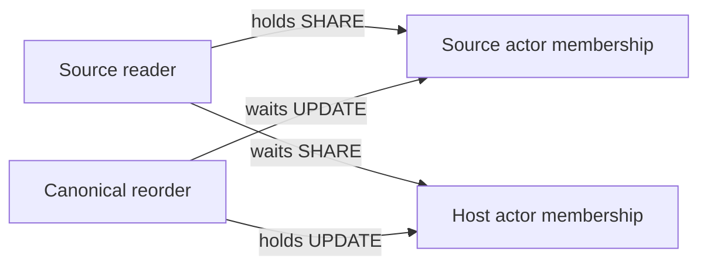

# #1178 source reader lock qualification

This pass characterized the candidate at Adea commit
`d11bd14201d62220a9d51251b2e81fd0bbf49e8c` and found a lock-order deadlock in the
production source reader. It is now repaired in the reader itself (see "Repair
applied"); the foreign-Agent HTTP guard is unchanged. Control-plane stays at
`a58ba51d93fd32f03815dbacdc3bd163dba0d627`.

## Actual acquisition order

`withCurrentSourceLeadTurnProduct` resolves the canonical intent and source mapping,
then takes source actor membership SHARE and source workspace SHARE. Its nested
host reader takes host workspace SHARE, host actor membership SHARE, host channel
UPDATE, and group admission/grant UPDATE locks. It then takes source Agent SHARE,
participant SHARE, host audience membership SHARE and message SHARE locks. Source
home, actor admission and enlistment are rechecked before the awaited verifier;
admission expiry is checked again afterward, while all locks remain held.

`reorderWorkspaces` takes the actor's users row UPDATE, reads the live workspace
list, then updates each actor membership in the caller's requested order. Before
the repair, the source reader never locked that users row.

## Deterministic deadlock (before the repair)

The reproducer calls the actual canonical reorder implementation. A query proxy
pauses it immediately after its first membership UPDATE completes. A source reader
then acquires the other membership SHARE and blocks on the first. Resuming reorder
completes the cycle. `pg_blocking_pids` establishes the first wait edge before
resumption; PostgreSQL reports SQLSTATE `40P01`. Reversing host and source also
reproduces `40P01`.



This was an availability defect in the candidate reader, not evidence of stale
authority acceptance: PostgreSQL aborts a transaction. The earlier characterization
tests expected the observed error; they now expect no error from either side.

## Other interleavings

- Opposite-direction readers for the same actor, with distinct host groups, both
  reach their awaited verifiers and complete while holding their authority locks.
- Source membership downgrade and canonical enlistment revocation both block
  behind a reader paused in final verification. The read linearizes before both
  mutations, then a fresh read denies. Existing source product tests independently
  cover revocation and expiry before and after awaited verification.
- An awaited verifier that itself awaits canonical grant revocation through another
  connection creates an application wait cycle: reader awaits writer, writer awaits
  the reader's held grant lock. A bounded 150 ms lock timeout produces `55P03`.
  This verifier deliberately catches that timeout for characterization. Final
  verification must not await writers requiring the enclosing transaction's locks.

## Repair applied

`withCurrentSourceLeadTurnProduct` now takes the canonical original actor's users
row `FOR SHARE` in its transaction **before** the source membership, source
workspace or any host authority lock. Canonical reorder already holds that same row
`FOR UPDATE` before writing memberships, so the two paths now acquire in one order
and the membership cycle cannot form. Concurrent readers share the actor fence. No
profile, model, authority, expiry or admission check changed, and source authority
is not replaced by host authority.

Review of the other lock orders that write memberships or delete workspaces:
`createWorkspaceWithOwner`, `ensureBootstrapWorkspaces`, `reorderWorkspaces`,
`beginWorkspaceDeletion`, the deletion completion path, identity claim and portable
import all take the actor's users row `FOR UPDATE` first. None takes a membership
lock and then requests a users row, so none can close a cycle with the reader. A
reader in final verification now delays those management writers for the same actor
until it finishes, the same bounded wait membership and grant writers already had.

Not solved by this repair: an awaited verifier that itself awaits a writer needing
the enclosing transaction's locks (see the reentry test). Final verification must not
do that.

## Reproduction and boundary

Use an owned disposable loopback PostgreSQL database only, initialized with the
repository's canonical `db:verify` migration runner (52 migrations plus deterministic
rerun). Set both database URLs to that disposable fixture and run:

```sh
bun --conditions=react-server test \
  ./packages/db/tests/integration/lead-source-lock-order.test.ts \
  ./packages/db/tests/integration/lead-source-product.test.ts
```

The file has seven tests: reverse readers, concurrent revocation, two directions of
the production reader against canonical reorder (fails with SQLSTATE 40P01 if the
actor fence is removed), two directions of reorder queuing behind a reader in final
verification, and verifier reentry. No test wraps or replaces the reader. No shared
database, production endpoint, physical source tool, external grant, runtime or
credential was created or altered. Physical-source qualification remains blocked
on the unresolved designated source execution destination.
