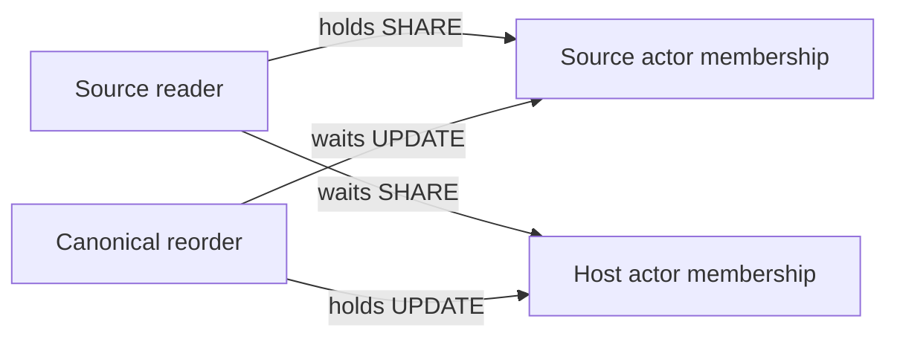

# #1178 source reader lock qualification

This pass characterizes the candidate at Adea commit
`d11bd14201d62220a9d51251b2e81fd0bbf49e8c`. It adds tests and this evidence only;
the production reader and foreign-Agent HTTP guard remain unchanged. Control-plane
stays at `a58ba51d93fd32f03815dbacdc3bd163dba0d627`.

## Actual acquisition order

`withCurrentSourceLeadTurnProduct` resolves the canonical intent and source mapping,
then takes source actor membership SHARE and source workspace SHARE. Its nested
host reader takes host workspace SHARE, host actor membership SHARE, host channel
UPDATE, and group admission/grant UPDATE locks. It then takes source Agent SHARE,
participant SHARE, host audience membership SHARE and message SHARE locks. Source
home, actor admission and enlistment are rechecked before the awaited verifier;
admission expiry is checked again afterward, while all locks remain held.

`reorderWorkspaces` takes the actor's users row UPDATE, reads the live workspace
list, then updates each actor membership in the caller's requested order. The
source reader currently never locks that users row.

## Deterministic deadlock

The reproducer calls the actual canonical reorder implementation. A query proxy
pauses it immediately after its first membership UPDATE completes. A source reader
then acquires the other membership SHARE and blocks on the first. Resuming reorder
completes the cycle. `pg_blocking_pids` establishes the first wait edge before
resumption; PostgreSQL reports SQLSTATE `40P01`. Reversing host and source also
reproduces `40P01`.



This is an availability defect in the candidate reader, not evidence of stale
authority acceptance: PostgreSQL aborts a transaction. The tests deliberately
expect the observed error and therefore passing them does not mean it is repaired.

## Other interleavings

- Opposite-direction readers for the same actor, with distinct host groups, both
  reach their awaited verifiers and complete while holding their authority locks.
- Source membership downgrade and canonical enlistment revocation both block
  behind a reader paused in final verification. The read linearizes before both
  mutations, then a fresh read denies. Existing source product tests independently
  cover revocation and expiry before and after awaited verification.
- An awaited verifier that itself awaits canonical grant revocation through another
  connection creates an application wait cycle: reader awaits writer, writer awaits
  the reader's held grant lock. A bounded 150 ms lock timeout produces `55P03`.
  This verifier deliberately catches that timeout for characterization. Final
  verification must not await writers requiring the enclosing transaction's locks.

## Smallest proposed repair, not applied

Acquire the canonical original actor's users row SHARE in the source reader's
transaction **before** source or host authority locks. Canonical reorder already
holds that same row UPDATE before membership writes. This prevents the observed
cycle without changing profiles/models, replacing source authority with host
authority, or changing the expiry/admission checks. Concurrent readers can share
the actor fence.

The tests apply that single gate in a test-only wrapper around the unchanged
reader. Both directions complete without errors with this gate. This proves only
the reproduced reorder cycle; review other management/deletion lock orders before
applying a production repair. It does not solve verifier reentry into writers.

## Reproduction and boundary

Use an owned disposable loopback PostgreSQL database only, initialized with the
repository's canonical `db:verify` migration runner (52 migrations plus deterministic
rerun). Set both database URLs to that disposable fixture and run:

```sh
bun --conditions=react-server test \
  ./packages/db/tests/integration/lead-source-lock-order.test.ts \
  ./packages/db/tests/integration/lead-source-product.test.ts
```

The new file has seven tests: reverse readers, concurrent revocation, two deadlock
directions, two test-only serialization directions, and verifier reentry. No shared
database, production endpoint, physical source tool, external grant, runtime or
credential was created or altered. Physical-source qualification remains blocked
on the unresolved designated source execution destination.
